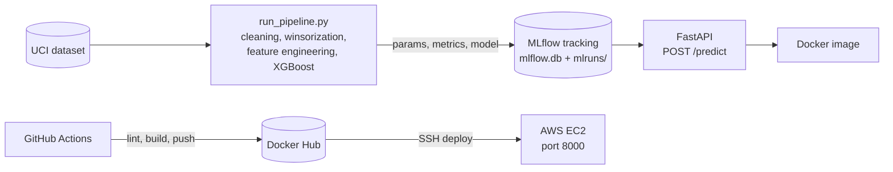

# Credit Risk Scoring: from notebooks to a deployed API

Predicting whether a credit card client will **default next month**, then shipping the model as a
containerized **FastAPI** service, tracked with **MLflow** and deployed to **AWS EC2** by a
**GitHub Actions** CI/CD pipeline.

Machine Learning module project at ENSIAS (2025-2026).


## The problem

- **Data:** [UCI *Default of Credit Card Clients*](https://archive.ics.uci.edu/dataset/350/default+of+credit+card+clients),
  30,000 clients (Taiwan, April to September 2005), 23 features: demographics, repayment status,
  bill and payment amounts.
- **Imbalance:** only 22% of clients default.
- **Business goal:** a missed default (false negative) costs far more than refusing a good client
  (false positive). Accuracy is the wrong target; the model must **catch defaults** while keeping a
  usable approval rate.

## Results

Stratified test set: 9,000 clients (30%), of which 1,991 defaults.

| Model | Decision threshold | Recall (default) | Precision (default) | F1 | ROC-AUC |
|---|---|---|---|---|---|
| Naive Bayes (SMOTE + PowerTransformer) | 0.50 | 59.3% | 42.0% | 0.49 | n/a |
| Decision Tree (balanced class weights) | 0.50 | 67.7% | 40.3% | 0.51 | 0.754 |
| SVM (RBF) | 0.50 | 43% | 58% | 0.49 | 0.757 |
| MLP (Keras, tuned) | 0.50 | 89% | 29% | 0.44 | 0.773 |
| **XGBoost (selected)** | **0.366** | **80.0%** | **35%** | **0.49** | **0.783** |

Source: `notebooks/3.0_NB_AD_XGB.ipynb` and `notebooks/4.0_MLP_KNN_SVM.ipynb`.

**Why XGBoost:** best ranking power (highest AUC), and its probabilities can be thresholded to hit a
recall target, unlike the MLP, which reaches high recall only with a very low precision.

### Decision threshold

The standard 0.5 threshold misses too many defaults. The threshold is read off the
precision-recall curve as the **highest threshold that still catches at least 80% of defaults**
(0.366). The trade-off is explicit: recall rises to 80%, precision falls to 35%.
The business cost of this operating point is reported with a false negative weighted 20 times a
false positive: 399 missed defaults and 2,957 false alarms.

### Production pipeline (`src/`)

The training code was refactored from the notebooks into a reproducible pipeline. Each run logs its
hyperparameters, decision threshold and metrics to MLflow:

| Run | Threshold | Recall | Precision | F1 | ROC-AUC |
|---|---|---|---|---|---|
| `src/pipeline/run_pipeline.py` (model served by the API) | 0.35 | 74.1% | 37.3% | 0.50 | 0.773 |

### Unsupervised insight

K-Means (k = 4, elbow method) with a PCA projection isolates a segment where **60% of clients
default**, without using the labels. This confirms the behavioral signals the supervised models rely
on.

## MLOps architecture



- **Feature engineering** (`src/features/build_features.py`): `SD_COUNT` (number of severe delays of
  2 months or more), `TOTAL_PAY_RATIO` (solvency), `UTILIZATION_RATIO` (credit limit usage), and
  winsorization at the 99th percentile with limits learned on the training set only.
- **Serving** (`src/app/main.py`): the API loads the latest MLflow run, applies the same
  preprocessing as training, and returns a probability, a 0/1 decision and a risk level.
- **CI/CD** (`.github/workflows/ci.yml`): on every push to `main`, flake8 lint, Docker build and push
  to Docker Hub, then deployment to an EC2 instance over SSH.

## Run it

```bash
pip install -r requirements.txt

# Train and log a model to MLflow
python -m src.pipeline.run_pipeline

# Serve the API (docs at http://localhost:8000/docs)
uvicorn src.app.main:app --port 8000

# Or with Docker
docker build -t credit-risk-ml .
docker run -p 8000:8000 credit-risk-ml
```

Example request (first client of the dataset):

```bash
curl -X POST http://localhost:8000/predict -H "Content-Type: application/json" -d '{
  "LIMIT_BAL": 20000, "SEX": 2, "EDUCATION": 2, "MARRIAGE": 1, "AGE": 24,
  "PAY_1": 2, "PAY_2": 2, "PAY_3": -1, "PAY_4": -1, "PAY_5": -2, "PAY_6": -2,
  "BILL_AMT1": 3913, "BILL_AMT2": 3102, "BILL_AMT3": 689, "BILL_AMT4": 0, "BILL_AMT5": 0, "BILL_AMT6": 0,
  "PAY_AMT1": 0, "PAY_AMT2": 689, "PAY_AMT3": 0, "PAY_AMT4": 0, "PAY_AMT5": 0, "PAY_AMT6": 0
}'
```

Response format: `{"probability": <float>, "prediction": 0 or 1, "risk_level": "High Risk" | "Low Risk"}`.

## Repository structure

```text
.github/workflows/ci.yml   CI/CD: lint, Docker build and push, EC2 deployment
src/
  data/                    loading and cleaning
  features/                feature engineering and winsorization
  models/                  training and evaluation (custom threshold)
  pipeline/run_pipeline.py end-to-end training run logged to MLflow
  app/                     FastAPI service and request/response schemas
notebooks/                 EDA, cleaning, model comparison, clustering
artifacts/                 feature order and winsorization limits used at inference
mlflow.db, mlruns/         MLflow tracking store and the served model
models/                    models saved from the notebooks
data/                      raw, interim and processed data
Dockerfile
requirements.txt
```

## Limitations and next steps

- Add unit and API tests to the CI (the workflow currently runs linting only).
- Use the MLflow Model Registry with a "production" alias instead of "latest run".
- Choose the threshold by minimizing an explicit cost function rather than a fixed recall target.
- Monitor score and feature drift on incoming requests.
